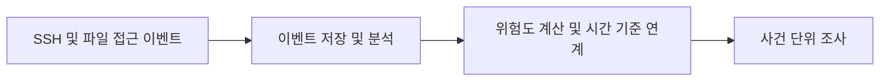

# DecoyTrace — Security Event Analysis

대학교 캡스톤디자인 · 2026.09~

## 프로젝트 개요
미끼 자산 관련 보안 이벤트를 수집하고 사건 단위로 연계하여 조사할 수 있도록 구성한 교육용 프로토타입입니다.

## 기술 및 검증 환경
- VMware / Ubuntu Linux
- Python, SQLite
- SSH 로그인 및 파일 접근 이벤트

## 수행 및 확인 범위
- SSH 로그인과 파일 접근 이벤트를 분석 대상으로 사용했습니다.
- 이벤트 수집, 위험도 계산 및 시간 기준 사건 연계 기능을 테스트했습니다.
- 10분 기준으로 테스트 이벤트 10건을 사건 3건으로 분류하는 결과를 확인했습니다.

## 검증 결과
| 항목 | 확인 내용 |
|---|---|
| 입력 | 테스트 이벤트 10건 |
| 연계 기준 | 10분 |
| 출력 | 사건 3건 |

위 수치는 기능 테스트 결과이며 탐지율, 오탐률 또는 성능 향상 지표가 아닙니다.

## 추가 개발 및 검증
프로젝트 발표 자료에는 사건 타임라인, SHA-256 무결성 검증, 웹 대시보드가 포함되어 있습니다. 전체 통합 테스트 결과와 개인별 구현 범위는 별도 확인이 필요하므로 본 문서에서는 완료 실적으로 주장하지 않습니다.

## 공개 범위
본 문서는 프로젝트 요약입니다. 팀 원본 코드 및 실제 로그는 포함하지 않습니다.
